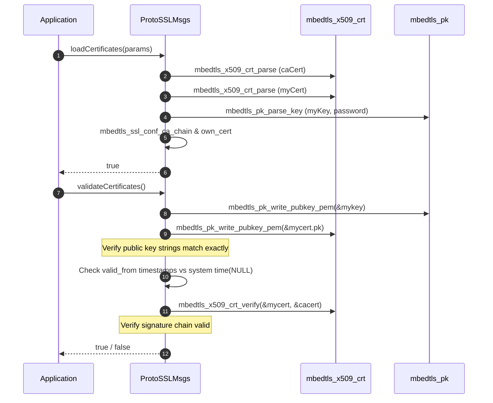
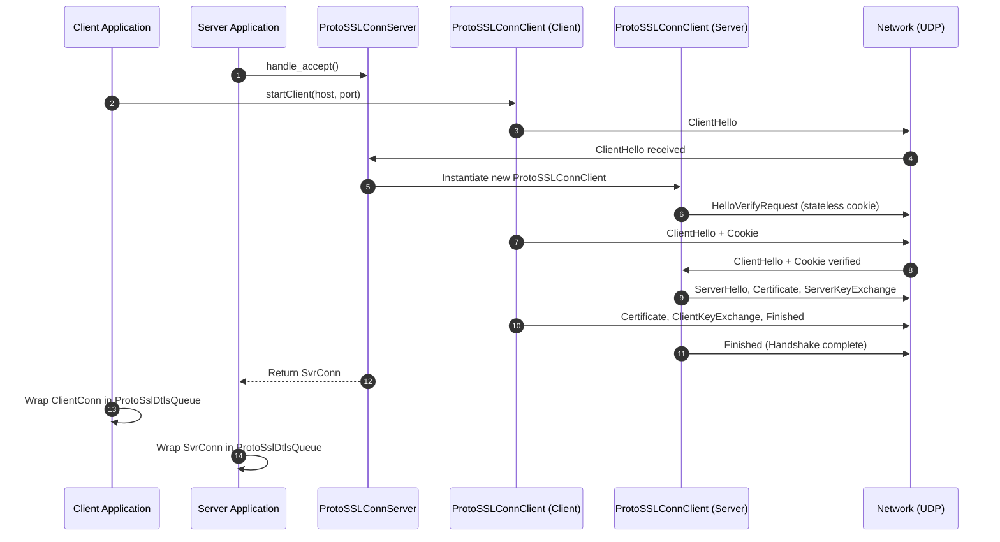
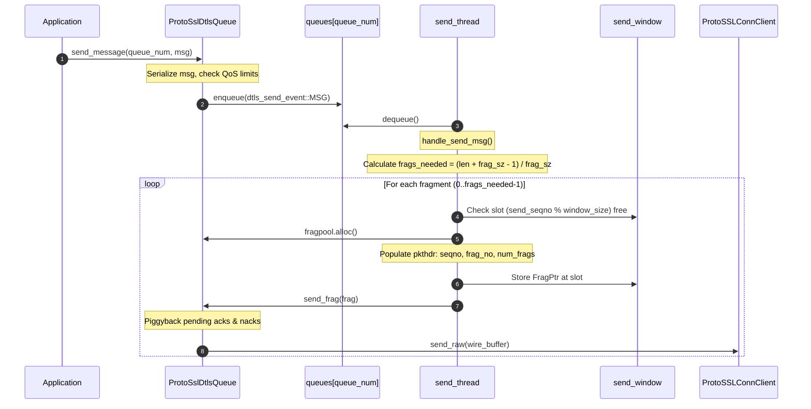
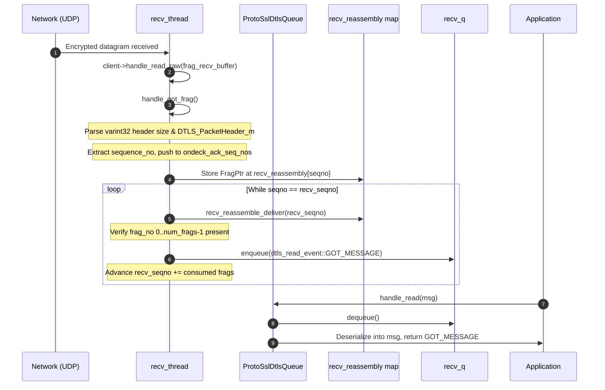
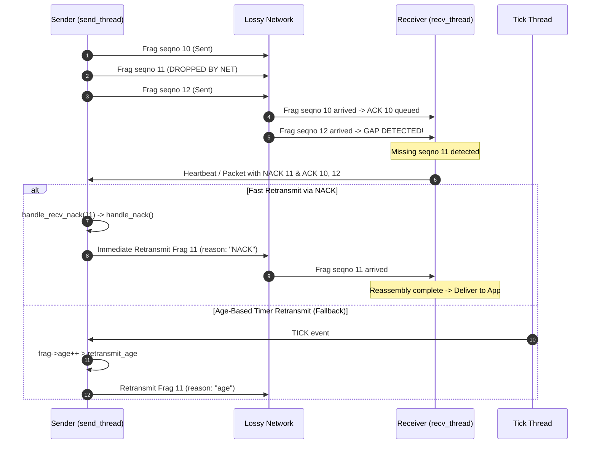
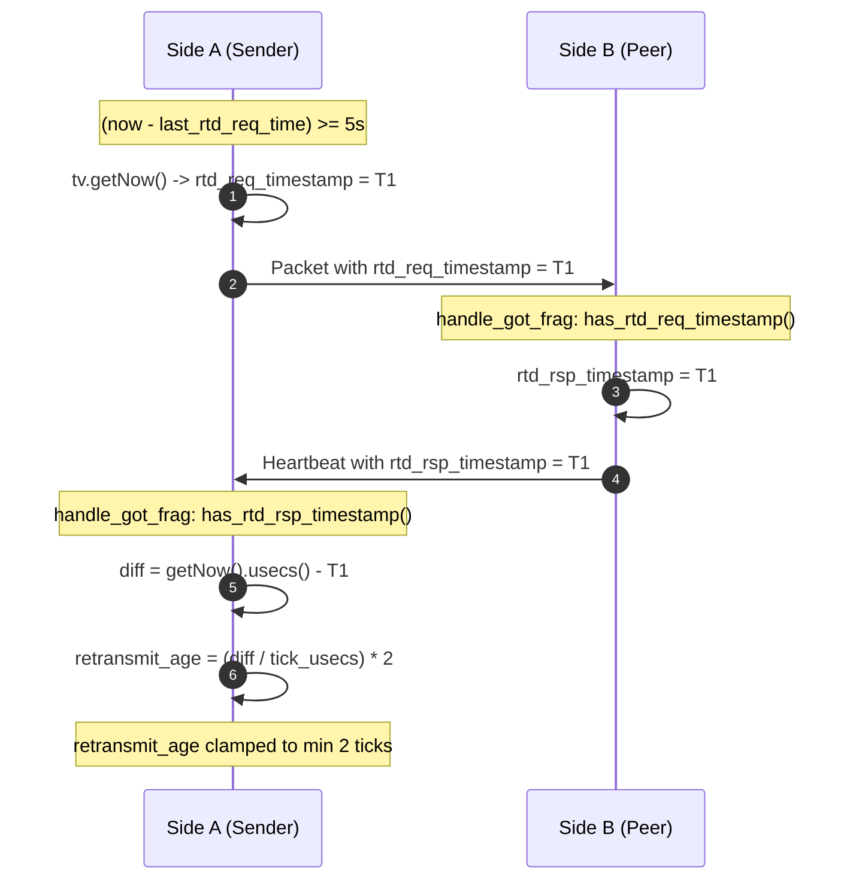
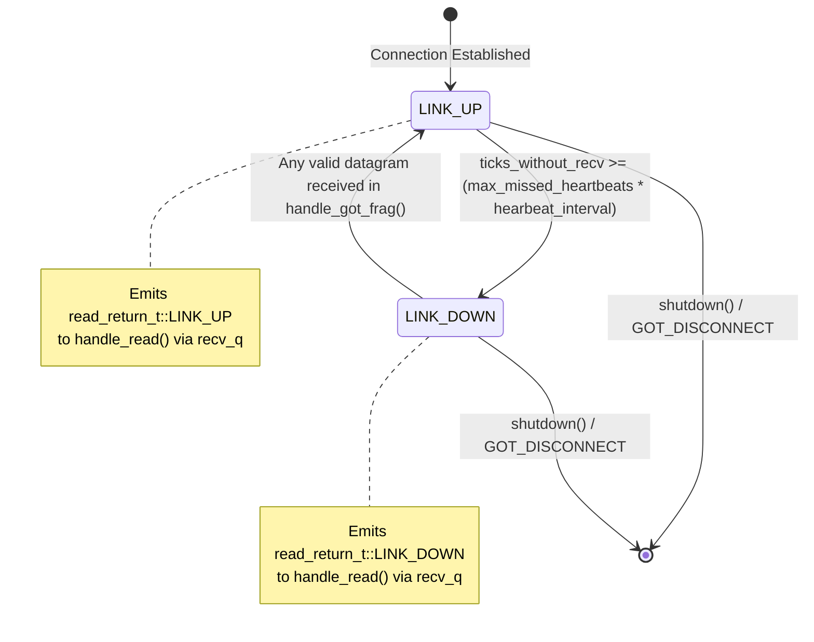

# libprotossl Architecture and Design Specification

`libprotossl` is a high-performance C++ networking and transport library that bridges **mbedtls** (SSL/TLS/DTLS) cryptographic framing with **Google Protocol Buffers** serialization. It provides secure connection abstractions for both streaming TCP (TLS) and datagram UDP (DTLS), and implements an advanced reliable, ordered, sliding-window transport protocol over DTLS (`ProtoSslDtlsQueue`).

---

## Table of Contents

1. [Architectural Overview](#1-architectural-overview)
2. [Component and Class Hierarchy](#2-component-and-class-hierarchy)
   - [2.1 Certificate and Key Management (`ProtoSSLCertParams`)](#21-certificate-and-key-management-protosslcertparams)
   - [2.2 SSL/TLS Engine and Manager (`ProtoSSLMsgs`)](#22-ssltls-engine-and-manager-protosslmsgs)
   - [2.3 Secure Connection Endpoints (`ProtoSSLConnClient` & `ProtoSSLConnServer`)](#23-secure-connection-endpoints-protosslconnclient--protosslconnserver)
   - [2.4 Reliable DTLS Queuing Engine (`ProtoSslDtlsQueue`)](#24-reliable-dtls-queuing-engine-protossldtlsqueue)
   - [2.5 DTLS Queue Configuration (`ProtoSslDtlsQueueConfig`)](#25-dtls-queue-configuration-protossldtlsqueueconfig)
   - [2.6 Telemetry and Statistics (`ProtoSslDtlsQueueStatistics`)](#26-telemetry-and-statistics-protossldtlsqueuestatistics)
3. [Memory Management and Smart Pointer Internals](#3-memory-management-and-smart-pointer-internals)
   - [3.1 `dtls_fragment` Lifetime & `FragPtr` Intrusive Smart Pointer](#31-dtls_fragment-lifetime--fragptr-intrusive-smart-pointer)
   - [3.2 Pre-allocated Memory Pools (`fragpool_t`, `thread_slinger_pool`)](#32-pre-allocated-memory-pools-fragpool_t-thread_slinger_pool)
4. [Wire Framing Protocol (`DTLS_PacketHeader_m`)](#4-wire-framing-protocol-dtls_packetheader_m)
5. [Threading Architecture and Synchronization](#5-threading-architecture-and-synchronization)
   - [5.1 Thread Responsibilities](#51-thread-responsibilities)
   - [5.2 Concurrency and Lock Hierarchy](#52-concurrency-and-lock-hierarchy)
6. [Detailed Execution Sequences](#6-detailed-execution-sequences)
   - [6.1 Certificate Loading & Strict Validation](#61-certificate-loading--strict-validation)
   - [6.2 Connection Establishment & DTLS Handshake](#62-connection-establishment--dtls-handshake)
   - [6.3 Reliable Message Transmission and Segmentation](#63-reliable-message-transmission-and-segmentation)
   - [6.4 Datagram Ingestion, Reassembly, and Piggybacked Acknowledgment](#64-datagram-ingestion-reassembly-and-piggybacked-acknowledgment)
   - [6.5 Loss Recovery: Retransmission via Age Timeout & Fast NACK](#65-loss-recovery-retransmission-via-age-timeout--fast-nack)
   - [6.6 Dynamic Round-Trip Delay (RTD) Calculation](#66-dynamic-round-trip-delay-rtd-calculation)
   - [6.7 Multi-Queue Scheduling & QoS Backpressure](#67-multi-queue-scheduling--qos-backpressure)
   - [6.8 Heartbeat Engine, Link Down & Link Up Transitions](#68-heartbeat-engine-link-down--link-up-transitions)
   - [6.9 Graceful Teardown and Race-Free Shutdown](#69-graceful-teardown-and-race-free-shutdown)
7. [Error Handling and Edge Cases](#7-error-handling-and-edge-cases)

---

## 1. Architectural Overview

The library operates on three distinct functional layers:

```
+-------------------------------------------------------------------------+
|                           Application Layer                             |
|        (Sends / receives Google Protocol Buffers: proto.pb.h)           |
+------------------------------------+------------------------------------+
|   Basic Streaming / Datagram API   |   Reliable Sliding-Window Engine   |
| (ProtoSSLConnClient/ConnServer)    |        (ProtoSslDtlsQueue)         |
|   - Non-blocking I/O               |   - Multi-queue QoS (FIFO/STACK)   |
|   - Protobuf prefix framing        |   - Chunk fragmentation & reasm    |
|   - Peer X.509 CN / Email extract  |   - Piggybacked ACKs / NACKs       |
|                                    |   - Dynamic RTD & retransmission   |
|                                    |   - Heartbeat & link-state events  |
+------------------------------------+------------------------------------+
|                         Crypto & SSL Layer                              |
|                          (ProtoSSLMsgs)                                 |
|   - mbedtls entropy sources & CTR-DRBG random seed generator            |
|   - X.509 Certificate parsing, CA chain verification, key matching      |
|   - DTLS HelloVerifyRequest stateless cookie generation & validation    |
|   - Non-blocking / blocking BIO configuration                           |
+-------------------------------------------------------------------------+
|                         OS / Network Layer                              |
|           (POSIX Sockets, UDP Datagrams, TCP Streams, Pipes)            |
+-------------------------------------------------------------------------+
```

---

## 2. Component and Class Hierarchy

### 2.1 Certificate and Key Management (`ProtoSSLCertParams`)

Defined in `libprotossl.h` and implemented in `protosslcertparams.cc`.

Encapsulates the credentials needed for mutual TLS authentication. It supports loading certificates and keys from the filesystem (using the `"file:"` URI scheme) or directly from in-memory PEM string buffers.

#### Fields
- `const std::string caCert`: Root CA certificate path or raw PEM content.
- `const std::string myCert`: Local endpoint certificate path or raw PEM content.
- `const std::string myKey`: Private key path or raw PEM content.
- `const std::string myKeyPassword`: Passphrase for encrypted private keys (optional).

---

### 2.2 SSL/TLS Engine and Manager (`ProtoSSLMsgs`)

Defined in `libprotossl.h` and implemented in `protosslmsgs.cc`.

Acts as the central context manager for mbedtls configurations, cryptographic entropy, and active socket lists.

#### Key Attributes
- `mbedtls_entropy_context entropy`: System entropy collector.
- `mbedtls_ctr_drbg_context ctr_drbg`: Counter-mode Deterministic Random Bit Generator seeded with the personality string `"ProtoSSLDRBG"`.
- `mbedtls_x509_crt cacert`: Parsed X.509 CA certificate chain.
- `mbedtls_x509_crt mycert`: Parsed local X.509 endpoint certificate.
- `mbedtls_pk_context mykey`: Parsed private key (RSA, EC, etc.).
- `mbedtls_ssl_config sslcfg`: Master SSL configuration applied to all spawned clients and servers.
- `mbedtls_ssl_cookie_ctx cookie_ctx`: DTLS cookie context for RFC 6347 anti-DoS `HelloVerifyRequest` cookies.
- `bool nonBlockingMode`: Whether created sockets operate in non-blocking mode.
- `bool debugFlag`: Enables verbose mbedtls internal debugging logs (threshold `999`).
- `bool use_tcp`: Configures `MBEDTLS_SSL_TRANSPORT_STREAM` (TCP) vs `MBEDTLS_SSL_TRANSPORT_DATAGRAM` (UDP).
- `ClientList_t clientList`: Intrusive doubly linked list (`DLL3`) tracking active `ProtoSSLConnClient` instances.
- `ServerList_t serverList`: Intrusive doubly linked list (`DLL3`) tracking active `ProtoSSLConnServer` instances.

#### Key Functions
- `ProtoSSLMsgs(bool nonBlockingMode, bool debugFlag, uint32_t read_timeout, bool use_tcp, uint32_t dtls_timeout_min, uint32_t dtls_timeout_max)`:
  Initializes mbedtls subsystems, seeds DRBG from entropy, configures transport type, authentication mode (`MBEDTLS_SSL_VERIFY_REQUIRED`), DTLS handshake retransmission timeouts, and cookie verification callbacks.
- `~ProtoSSLMsgs()`:
  Iteratively deletes all remaining registered server and client objects, and frees all mbedtls cryptographic contexts.
- `bool loadCertificates(const ProtoSSLCertParams &params)`:
  Parses CA certs, identity certs, and private keys (supporting password protection and mbedtls 2.x/3.x API differences). Attaches CA chain and own cert/key to `sslcfg`.
- `bool validateCertificates()`:
  Performs pre-flight certificate validation:
  1. Serializes the public key from `mykey` and `mycert.pk` into PEM and ensures exact byte equivalence.
  2. Inspects `valid_from` timestamps of `mycert` and all `cacert` chain elements against the current system time (`time(NULL)`).
  3. Executes `mbedtls_x509_crt_verify` on `mycert` against `cacert`.
- `ProtoSSLConnServer* startServer(int listeningPort)`:
  Allocates and binds a new `ProtoSSLConnServer`.
- `ProtoSSLConnClient* startClient(const std::string &remoteHost, int remotePort)`:
  Sets SSL configuration endpoint to `MBEDTLS_SSL_IS_CLIENT`, creates a new `ProtoSSLConnClient`, and initiates the connection and SSL handshake.

---

### 2.3 Secure Connection Endpoints (`ProtoSSLConnClient` & `ProtoSSLConnServer`)

Defined in `libprotossl.h` and implemented in `protosslconnclient.cc` and `protosslconnserver.cc`.

#### `ProtoSSLConnServer`
- Represents a listening socket bound to a specific TCP or UDP port.
- `handle_accept()`: Accepts incoming network connections via `mbedtls_net_accept`. For DTLS, it obtains the client IP and port, then instantiates a `ProtoSSLConnClient` and triggers handshake processing.

#### `ProtoSSLConnClient`
- Manages an established network context (`mbedtls_net_context netctx`), SSL session (`mbedtls_ssl_context sslctx`), and timing context (`mbedtls_timing_delay_context timer`).
- Inherits from `ClientList_t::Links` for intrusive tracking in `ProtoSSLMsgs`.
- **Concurrency Protection**: Protected by `WaitUtil::Lockable ssl_lock`.

#### Key Methods of `ProtoSSLConnClient`
- `init_common(unsigned char *client_ip, size_t cliip_len)`:
  Configures BIO callbacks (`mbedtls_net_send`, `mbedtls_net_recv`, `mbedtls_net_recv_timeout`). On DTLS servers, sets client transport ID for cookie verification. Drives `mbedtls_ssl_handshake()` in a loop handling `MBEDTLS_ERR_SSL_WANT_READ`, `MBEDTLS_ERR_SSL_WANT_WRITE`, and `MBEDTLS_ERR_SSL_HELLO_VERIFY_REQUIRED`.
- `read_return_t handle_read_raw(std::string &buffer)`:
  Reads decrypted wire bytes into `buffer` (sized up to `PROTOSSL_MAX_CONTENT_LEN`). Maps mbedtls return codes to `GOT_MESSAGE`, `READ_MORE`, `GOT_TIMEOUT`, or `GOT_DISCONNECT`.
- `bool send_raw(const std::string &buffer)`:
  Encrypts and transmits raw bytes through `mbedtls_ssl_write()`, retrying across `WANT_READ`/`WANT_WRITE` conditions.
- `read_return_t handle_read(MESSAGE &msg)`:
  Calls `handle_read_raw()` and deserializes into a Google Protobuf `MESSAGE`.
- `bool send_message(const MESSAGE &msg)`:
  Serializes Protobuf `MESSAGE` and passes buffer to `send_raw()`.
- `bool get_peer_info(ProtoSSLPeerInfo &info)`:
  Queries peer socket address via `getpeername()` and parses peer X.509 certificate subject DN entries (Common Name via `MBEDTLS_OID_AT_CN`, Email via `MBEDTLS_OID_PKCS9_EMAIL`, and OU via `MBEDTLS_OID_AT_ORG_UNIT`).

---

### 2.4 Reliable DTLS Queuing Engine (`ProtoSslDtlsQueue`)

Defined in `libprotossl.h` and implemented in `protossldtlsqueuing.cc`.

`ProtoSslDtlsQueue` wraps an existing `ProtoSSLConnClient` (taking ownership of its memory) and implements an enterprise-grade reliable sliding-window protocol over UDP/DTLS.

#### Key Responsibilities
- **Fragmentation & Segmentation**: Splits large Protobuf messages into datagram fragments no larger than `config.fragment_size`.
- **Sliding-Window Flow Control**: Restricts unacknowledged packets to `config.window_size`.
- **Out-of-Order Reassembly**: Indexes incoming fragments by non-modulo 32-bit sequence numbers using an internal map and delivers fully assembled messages in strict sequential order.
- **Piggybacked Acknowledgment & NACK**: Piggybacks ACKs and NACKs onto outgoing data packets and periodic heartbeats.
- **Adaptive Retransmission**: Solicits microsecond round-trip delay (RTD) timestamps and adjusts retransmission timeout dynamically.
- **QoS Priority Queuing**: Supports up to 8 distinct application queues with FIFO or STACK disciplines and message or byte limits.
- **Link State Detection**: Monitors keepalive heartbeats and raises `LINK_UP` and `LINK_DOWN` events.

---

### 2.5 DTLS Queue Configuration (`ProtoSslDtlsQueueConfig`)

Configures queuing behavior, protocol timeouts, and QoS queues:

| Field | Default | Description |
|---|---|---|
| `fragment_size` | `1250` bytes | Max payload bytes per datagram fragment. |
| `window_size` | `1000` | Max outstanding unacknowledged fragments. |
| `ticks_per_second` | `25` | Internal timer resolution (40ms tick). |
| `hearbeat_interval`| `25` ticks | Interval between heartbeats (1 second). |
| `max_missed_heartbeats`| `3` | Number of missed heartbeats before declaring `LINK_DOWN`. |
| `max_outstanding_acks` | `1` | Max unacknowledged packets before forcing immediate heartbeat ACK. |
| `max_outstanding_nacks`| `1` | Max queued NACKs before forcing immediate transmission. |

#### Queue Disciplines
- `Queue_Type_t`:
  - `FIFO`: Enqueued at tail, dequeued from head. When full, rejects new messages (`QOS_DROP`).
  - `STACK`: Enqueued at head, dequeued from head (LIFO). When full, drops oldest messages from the tail to make room for newer messages.
- `Limit_Type_t`:
  - `NONE`: Unbounded queue.
  - `MESSAGES`: Backpressure limit evaluated by message count.
  - `BYTES`: Backpressure limit evaluated by total serialized byte volume.

---

### 2.6 Telemetry and Statistics (`ProtoSslDtlsQueueStatistics`)

Maintains real-time link statistics:
- `bytes_sent`, `bytes_received`: Cumulative application payload bytes.
- `frags_sent`, `frags_received`: Total network fragments transmitted/received.
- `frags_resent`: Number of fragments retransmitted due to timeout or NACK.
- `missing_frags_detected`: Gaps identified during reassembly.

---

## 3. Memory Management and Smart Pointer Internals

### 3.1 `dtls_fragment` Lifetime & `FragPtr` Intrusive Smart Pointer

Network fragments undergo complex cross-thread lifecycles (allocated in send thread, referenced in `send_window`, referenced in retransmission handlers, or held in `recv_reassembly` and `recv_window`).

To ensure zero-leak, zero-double-free semantics with maximum performance:
1. `dtls_fragment` features an atomic reference count (`std::atomic_int refcount`).
2. `FragPtr` is an intrusive smart pointer managing `refcount` via `ref()` and `deref()`.
3. When `refcount` drops to zero, the fragment invokes `init()` (clearing its buffer and protobuf header) and returns itself to the custom memory pool `fragpool_t`.

```
                +---------------------------------------+
                |              fragpool_t               |
                +-------------------+-------------------+
                                    | alloc()
                                    v
                            +---------------+
                   +------->| dtls_fragment |<-------+
                   |        | refcount = 2  |        |
                   |        +---------------+        |
                   |                                 |
           +-------+--------+                +-------+--------+
           | FragPtr (copy) |                | FragPtr (orig) |
           | in send_window |                | in send_frag() |
           +----------------+                +----------------+
```

### 3.2 Pre-allocated Memory Pools

`libprotossl` relies on `ThreadSlinger::thread_slinger_pool` to eliminate runtime heap allocations in high-throughput hot paths:
- `send_msg_pool` (size 1000): Dedicated to application payload message events (`dtls_send_event::MSG`).
- `send_other_pool` (size 100): Dedicated to control events (`TICK`, `ACK`, `NACK`).
  *Separating control events from message events guarantees that ACKs and ticks can never be starved or deadlocked even under total message buffer saturation.*
- `read_pool` (size 1000): Used for delivery to `handle_read()` via `recv_q`.
- `fragpool_t`: Pre-allocated pool of `dtls_fragment` instances that expand dynamically in blocks of 10 if exhausted.

---

## 4. Wire Framing Protocol (`DTLS_PacketHeader_m`)

Every datagram transmitted by `ProtoSslDtlsQueue` uses length-delimited Protocol Buffers framing:

```
+-------------------+--------------------------------+------------------------+
| Varint32 Length   | Protobuf: DTLS_PacketHeader_m  | Raw Fragment Data      |
| (Size of Header)  | (Wire serialized packet header)| (Optional Binary Body) |
+-------------------+--------------------------------+------------------------+
```

### Protocol Buffer Definition (`protossldtlsqueuing.proto`)

```protobuf
syntax = "proto2";

package ProtoSSL.DTLS;

message DTLS_PacketHeader_m
{
  optional uint32 window_size        = 1; // Sender's send-window size
  optional uint32 sequence_no        = 2; // Absolute sequence number (reliable msgs)
  optional uint32 frag_no            = 3; // Chunk index (0 to num_frags - 1)
  optional uint32 num_frags          = 4; // Total chunks in segmented message
  repeated uint32 ack_seq_no         = 5; // Cumulative/selective piggybacked ACKs
  repeated uint32 nack_seq_no        = 6; // Piggybacked negative ACKs
  optional uint32 message_body_size  = 7; // Byte length of following payload
  optional uint64 rtd_req_timestamp  = 8; // Microseconds timestamp of sender
  optional uint64 rtd_rsp_timestamp  = 9; // Mirrored timestamp for RTD calc
}
```

---

## 5. Threading Architecture and Synchronization

### 5.1 Thread Responsibilities

Each `ProtoSslDtlsQueue` instance manages three dedicated worker threads:

```
                      +-----------------------------+
                      |      User Application       |
                      +--------------+--------------+
                        send_message |  ^ handle_read
                                     v  |
                   +--------------------+-------------------+
                   |           ProtoSslDtlsQueue            |
                   +--------+-----------+-----------+-------+
                            |           |           |
            +---------------+           |           +---------------+
            v                           v                           v
  +-------------------+       +-------------------+       +-------------------+
  |    tick_thread    |       |    send_thread    |       |    recv_thread    |
  |                   |       |                   |       |                   |
  | - 25 Hz timer     |       | - Multi-Q dequeue |       | - Selects on FD   |
  | - Closer pipe sel |       | - Window sizing   |       | - Reads DTLS raw  |
  | - Emits TICK to   |       | - Retransmission  |       | - Parses header   |
  |   send_q          |       | - Piggybacks ACKs |       | - Assembles frags |
  |                   |       | - Calls send_raw  |       | - Enqueues to     |
  |                   |       |                   |       |   recv_q          |
  +-------------------+       +-------------------+       +-------------------+
```

1. **`tick_thread`**:
   - Executes a periodic timer using `pxfe_select()` on `closer_pipe.readEnd` with a microsecond timeout calculated as `1000000 / config.ticks_per_second`.
   - On each tick, allocates an event from `send_other_pool` and enqueues a `TICK` event into `send_q`.
   - Terminates immediately when `closer_pipe` becomes readable.

2. **`send_thread`**:
   - The central transmission arbiter.
   - Executes `dtls_thread_queue_t::dequeue()` across all active priority queues (`queues[0..N]`).
   - If the sliding send window is full, enters flow-control mode: it stops dequeuing from message queues and only processes control events (`TICK`, `ACK`, `NACK`, `DIE`) from `send_q` (queue 0).
   - Segments large messages into fragments, stores them in `send_window`, and transmits them via `send_frag()`.
   - On `TICK`, increments fragment age and retransmits expired fragments.
   - Manages heartbeat intervals and flushes pending ACKs/NACKs.

3. **`recv_thread`**:
   - Monitors the underlying socket descriptor (`client->get_fd()`) and `closer_pipe.readEnd` using `pxfe_select()`.
   - Calls `client->handle_read_raw()` to ingest incoming DTLS datagrams.
   - Decodes `DTLS_PacketHeader_m` and payload body.
   - Dispatches received ACKs/NACKs to `send_thread` or updates `send_window`.
   - Buffers out-of-order reliable fragments in `recv_reassembly`, triggers sequential message delivery to `recv_q`, and dispatches unreliables immediately.

### 5.2 Concurrency and Lock Hierarchy

To prevent deadlocks and race conditions:
- **`dtls_lock`**:
  Protects shared state within `ProtoSslDtlsQueue`:
  - `send_window`, `recv_window`, `recv_reassembly`
  - `ondeck_ack_seq_nos`, `ondeck_nack_seq_nos`
  - `queue_sizes[]` counters
  - `link_up` and `link_changed` flags
  - `client` pointer lifecycle
- **Lock Ordering Rules**:
  - `dtls_lock` must **never** be held while calling blocking memory allocations (`send_msg_pool.alloc(-1)`) or blocking queue dequeues.
  - Slinger queues (`dtls_thread_queue_t`) and pools (`thread_slinger_pool`) are internally thread-safe and never require `dtls_lock`.
  - When calling `ProtoSSLConnClient::send_raw()` or `handle_read_raw()`, `ProtoSSLConnClient::ssl_lock` is acquired internally.

---

## 6. Detailed Execution Sequences

### 6.1 Certificate Loading & Strict Validation



---

### 6.2 Connection Establishment & DTLS Handshake

Illustrates DTLS client-server connection, cookie verification (`HelloVerifyRequest`), and queue wrapping:



---

### 6.3 Reliable Message Transmission and Segmentation

When an application transmits a Protobuf message larger than `config.fragment_size`:



---

### 6.4 Datagram Ingestion, Reassembly, and Piggybacked Acknowledgment



---

### 6.5 Loss Recovery: Retransmission via Age Timeout & Fast NACK

Demonstrates recovery when a packet chunk is dropped in transit:



---

### 6.6 Dynamic Round-Trip Delay (RTD) Calculation

Every 5 seconds, `ProtoSslDtlsQueue` samples round-trip network latency to tune retransmission aggression:



---

### 6.7 Multi-Queue Scheduling & QoS Backpressure

`ProtoSslDtlsQueue` allows fine-grained traffic differentiation across application priorities:

```
+-------------------------------------------------------------------------------+
|                               Multi-Queue Dispatcher                          |
+-------------------------------------------------------------------------------+
|  Queue 0: Internal Control Events (TICK, ACK, NACK, DIE)    [Highest Priority]|
|  Queue 1: High-Priority Control / RPC (FIFO, Messages limit)                  |
|  Queue 2: Bulk Data Streaming (FIFO, Byte limit: 64 KB)                       |
|  Queue 3: Telemetry Stream (STACK, drops tail when limit reached)             |
+-------------------------------------------------------------------------------+
```

#### Behavior Comparison: `FIFO` vs `STACK`

```
1. FIFO Queue with MESSAGES limit (e.g., limit = 2):
   Incoming: [Msg A] -> [Msg B] -> [Msg C attempts entry]
   Result: [Msg C] is rejected immediately with return code QOS_DROP.

2. STACK Queue with BYTES limit (e.g., limit = 64KB):
   Incoming: [New Msg (Head)] enters -> Total bytes > limit
   Result: Oldest message at the TAIL is silently dequeued and released,
           preserving the freshest data at the head.
```

---

### 6.8 Heartbeat Engine, Link Down & Link Up Transitions



---

### 6.9 Graceful Teardown and Race-Free Shutdown

A primary engineering challenge in multi-threaded network engines is avoiding race conditions between application teardown and pending reads/writes. `ProtoSslDtlsQueue::shutdown()` implements a coordinated shutdown barrier:

```mermaid
sequenceDiagram
    autonumber
    participant App as App / Destructor
    participant DtlsQ as ProtoSslDtlsQueue
    participant Pipe as closer_pipe
    participant SendTh as send_thread
    participant RecvTh as recv_thread
    participant TickTh as tick_thread
    participant Client as ProtoSSLConnClient

    App->>DtlsQ: shutdown() (acquires dtls_lock)
    Note over DtlsQ: Set l_client = client; client = NULL;
    DtlsQ->>Pipe: write(closer_pipe, 1 byte)
    DtlsQ->>SendTh: Enqueue dtls_send_event::DIE (send_q)
    
    Par Parallel Thread Exit
        Pipe-->>TickTh: Select wakes -> tick_thread exits
    and
        Pipe-->>RecvTh: Select wakes -> recv_thread exits
    and
        SendTh->>SendTh: Dequeues DIE -> Enqueues GOT_DISCONNECT to recv_q -> exits
    end

    DtlsQ->>DtlsQ: pthread_join all 3 threads
    DtlsQ->>Client: delete l_client (safe and clean!)
    DtlsQ-->>App: Return complete
```

---

## 7. Error Handling and Edge Cases

| Condition | Internal Handling & Behavior |
|---|---|
| **`MBEDTLS_ERR_SSL_HELLO_VERIFY_REQUIRED`** | Handled natively in `ProtoSSLConnClient::init_common()`. Normal DTLS cookie handshake challenge; resets session and awaits verified retry from client. |
| **Duplicate Datagram Arrival** | `handle_got_frag()` detects `seqno` already present in `recv_reassembly`. Suppresses double-delivery to the application and re-emits an ACK to update the remote sender. |
| **Out-of-Order Datagram Arrival** | Stored in `recv_reassembly` map. Delivery thread advances strictly sequentially, stalling delivery until all gap sequence numbers arrive. |
| **Lost Acknowledgment** | Sender retransmits chunk on timeout. Receiver detects fragment has already been delivered (`delivered == true`), does not duplicate delivery, and re-acknowledges. |
| **Send Window Saturation** | When `send_seqno + frags_needed` overlaps an unacknowledged slot in `send_window`, `send_thread` halts message dequeuing and parks on `send_q` until ACKs clear slots. |
| **Remote Socket Disconnect** | `handle_read_raw()` returns `MBEDTLS_ERR_NET_CONN_RESET` or 0; `ProtoSSLConnClient` frees network socket, emits `GOT_DISCONNECT` to `recv_q`, and wakes up reader. |
| **Object Destruction During `handle_read()`** | `shutdown()` pushes `GOT_DISCONNECT` into `recv_q` before joining threads, immediately unblocking any application thread waiting inside `handle_read()`. |
